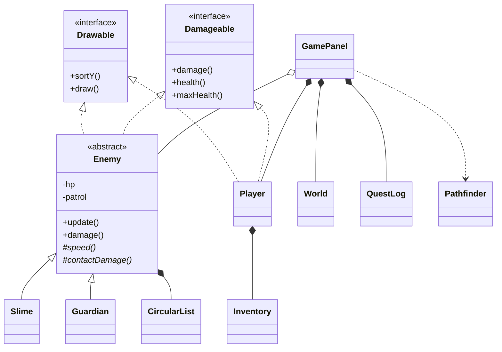

# Final game specification

**Title:** Agyu: Guardians of the Lost Grove

**Platform:** Java 17+, desktop, keyboard, Java Swing/Java2D

**Format:** one compact 64 x 48 tile world, single player, offline

**Course purpose:** one playable game that makes DSA and OOP visible in real behavior

**Story:** an original fictional adventure; do not describe invented shrines or enemies as authentic folklore.

## Release scope

The implemented journey is: title -> exploration -> clear three shrine guard groups -> restore three shrines -> fight the awakened guardian -> return home -> victory.

Included: movement/run, Space jumping, six-move mouse spear combos with physical body animation, directional shield defense, health/hit reactions, herbs, three seals, two enemy types, visible guardian pulse warning, five named beacons, connected roads, map, journal, optional route trail, pause, defeat/victory, restart, pixel rendering, and diagnostics.

This is a deliberately short, complete classroom game loop. Actual play length and difficulty still require human testing. It is not an open-world RPG. Save files, crafting, multiplayer, equipment trees, large dialogue systems, and additional levels are outside this release.

## Confirmed course coverage

The student confirmed arrays, linked lists, queues, and stacks for DSA, and inheritance, encapsulation, polymorphism, and abstraction for OOP. The phrase "etc." is not a complete syllabus. The following covers those confirmed topics and several useful standard extensions; obtain the remaining syllabus/rubric before claiming every course topic is covered.

| Topic | Actual game use | Source | Cost / explanation |
| --- | --- | --- | --- |
| Arrays / 2D arrays | Terrain, tile variants, cached walkability, distance/predecessor grids and combat poses [direction][move][phase] | World, Pathfinder, CombatBody | O(1) cell/pose access; O(R*C) storage |
| Singly linked circular list | Each enemy cycles through patrol waypoints around its shrine | CircularList, Enemy | Custom nodes; O(1) append/current/advance; O(k) space |
| Queue / FIFO | BFS frontier; enemy defeat events deferred until entity updates finish | Pathfinder.distances, GamePanel.processEvents | ArrayDeque addLast/removeFirst, amortized O(1) |
| Stack / LIFO | Reverse the goal-to-start predecessor chain into a start-to-goal route | Pathfinder.find | ArrayDeque push/pop; O(L) reconstruction |
| Dynamic array list | Active enemies and reused visible draw list | GamePanel | Amortized O(1) append; O(n) traversal |
| Hash map | Item quantity lookup; quest definitions by ID | Inventory, QuestLog | Expected O(1) lookup/update |
| Hash set | Held keys and completed quest IDs, including duplicate prevention | KeyHandler, QuestLog | Expected O(1) membership |
| Graph | Four-neighbor walkable tile graph; quest prerequisites form a small DAG | World, Pathfinder, QuestLog | Grid graph is implicit; no dense adjacency matrix |
| BFS | One shared distance field used by nearby enemies; reachability tests | Pathfinder.distances | O(V+E), O(V) space; on this grid E <= 4V |
| Heap / priority queue | Lowest estimated path cost selected during A* | Pathfinder.find | PriorityQueue insert/remove O(log V) on this bounded-degree grid |
| A* / searching | Optional trail to a nearby unfinished objective | Pathfinder.find, GamePanel.updateNavigation | Unit costs + consistent Manhattan heuristic; O(V log V) bound for this grid |
| Sorting / comparator | Visible objects sorted by feet Y for correct overlap | GamePanel.paintComponent | O(n log n) general comparison sort |
| Algorithm analysis | Exact collision equivalence, A* versus BFS lengths, measured counters | GameTests, F1 panel | Separate correctness evidence from timing claims |

The custom linked list demonstrates nodes and circular links. Queue, stack, heap, map and set currently use the Java Collections Framework. If the rubric requires implementing these ADTs from scratch, replace their implementations behind the same interfaces and add invariant tests. Using a library collection does not prove a custom ADT implementation.

The queue and stack are both backed by ArrayDeque but use different operation contracts: FIFO for BFS/events; LIFO for route reconstruction. Explain the operations, rather than claiming their backing container is a linked list.

## OOP pillars

| Pillar | Concrete evidence |
| --- | --- |
| Encapsulation | Inventory keeps its HashMap private and rejects invalid quantities; Player and Enemy keep health private and expose controlled damage/healing; QuestLog owns completion state |
| Abstraction | Abstract Enemy contains shared lifecycle, collision, rendering and navigation; speed/contactDamage are abstract operations |
| Inheritance | Slime and Guardian extend Enemy and reuse its behavior |
| Polymorphism | A List<Enemy> invokes update/draw on both concrete types; Guardian overrides update/draw and combat stats; Drawable and Damageable are focused interfaces |

Composition is also explicit: Player owns Inventory, JumpMotion, SpearAttack and ShieldGuard; SpearAttack stores six immutable move definitions in an array; Enemy owns CircularList patrol data; GamePanel owns World, Player, QuestLog and enemy objects. Enums represent input actions/items/player/session state; constructors establish initial health and inventory; IOException reports missing/unreadable art.

Some spatial state remains package-visible to fit the existing small Java project. The design does not claim every field is private or that the code is a full engine framework.

## Architecture

## Performance changes

- Preserve fixed 60 Hz simulation, elapsed-time cap, interpolation and nearest-neighbor scaling.
- Keep update and HUD/render reads under the same lock.
- Consume synchronized immutable input snapshots; suppress key autorepeat; clear inputs and pause on focus loss.
- Make loop startup idempotent and stop it when the window closes.
- Cache each tree's exact collider and index it in every overlapping grid cell. Query local cells instead of scanning all 85 trees per collision. This adds O(grid cells + indexed references) memory; a crowded bucket can still degrade to O(n).
- Precompute conservative enemy walkability once per world, reserving whole tiles plus actor clearance so routes cannot cross boundary tree trunks. Build one BFS field shared by enemies, at most once per 0.35 seconds while the target tile changes. A* runs only with the trail enabled, at most once per 0.6 seconds.
- Reuse the render list, cull off-screen trees/enemies, cache art, and cap live effects at 256 particles.
- Keep exact collision checks during movement. Navigation is a tile-center approximation; geometry and chase behavior still need manual playtesting around corners.

No measured FPS improvement or percentage speedup is claimed. F1 timings are rolling CPU measurements on the running machine. Indexed/brute-force equivalence is a correctness comparison, not an FPS benchmark.

## Verification and acceptance

Run test.bat to compile with -Xlint:all and perform:

- 20,000 seeded collision queries comparing the spatial index with a brute-force exact reference.
- Sweep every traversable navigation edge with an enemy-sized collider, including positions between tile centers.
- Verify a spear attack hits exactly once in all four directions and that healing consumes items only when needed.
- Every ordered pair of mission landmarks: reachable by BFS; A* length equals the BFS shortest distance; route steps are adjacent/walkable and end at the goal.
- Invalid/blocked endpoints, empty and circular linked-list behavior, item validation/overflow, prerequisite/duplicate quest guards, key autorepeat/focus clearing, and once-only defeat rewards.
- An automated session from title to all shrine interactions, guardian defeat and home victory; map/pause behavior; fresh-session state after victory and defeat.
- Off-screen renders for title, gameplay, map, journal, and victory under build/.

Remaining human acceptance:

1. Finish by playing normally, without teleporting or automated enemy damage.
2. Check spear hit alignment in all four directions and corner navigation.
3. Confirm guardian warning is understandable, herbs are sufficient, and difficulty is fair.
4. Switch focus during held movement; resume without stuck keys. Close the window and verify no game process remains.
5. Test on the presentation laptop at the intended display scale and record frame/update timings.
6. Replace placeholder guardian art if required by the art rubric; review the active Agyu replacement described in SPRITES.md.
7. Have another student complete the game using only the title screen, controls, map and journal.

## Outstanding syllabus decisions

Confirm whether "etc." includes doubly linked lists, array-based custom queues/stacks, recursion, binary search, tree traversals, BST/AVL, specific sorts, Dijkstra, greedy algorithms, backtracking, or dynamic programming.

Add those only when required, with a concrete feature and evidence: a dialogue tree for traversal/recursion, a sorted codex for binary search, weighted terrain for Dijkstra, or a small equipment-budget optimizer for dynamic programming. Do not claim them as implemented in the current release.

## Defense outline

1. Explain the player goal and show the three-shrine-to-guardian dependency.
2. Demonstrate movement, an encounter, a shrine reward, the map, and the navigation trail.
3. Show World arrays; CircularList node links and wraparound; FIFO events/BFS; LIFO path reversal.
4. Trace a call through List<Enemy> into Slime or Guardian, then show private health and controlled inventory methods.
5. Show test results and the F1 counters. Describe the spatial index tradeoff and why shared BFS avoids one search per enemy per frame.
6. State remaining art/balance work and show the final course checklist with implemented versus outstanding topics.

The due date, team responsibilities, complete syllabus, and instructor requirements are still unspecified.
