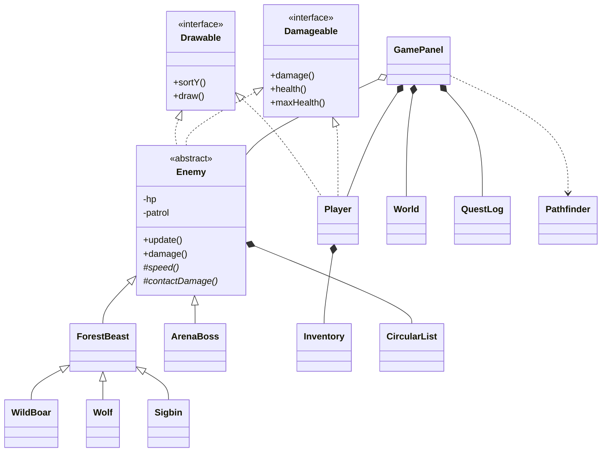

# Final game specification

**Title:** Agyu: Guardians of the Lost Grove

**Platform:** Java 17+, desktop, keyboard, Java Swing/Java2D

**Format:** a 192 x 160 tile world containing a 64 x 48 tile village and surrounding forest, single player, offline

**Course purpose:** one playable game that makes DSA and OOP visible in real behavior

**Story:** an original fictional adventure; do not describe the game's events as authentic cultural accounts.

## Release scope

The implemented journey is: title -> village -> open a gate -> randomized forest encounters -> defeat Tank/Mage/Fighter in any order -> victory.

Included: stamina sprinting, lightning dash, green health, orange energy and blue potion shield bars, Space jumping, six-stage spear combos, directional shield defense, three usable potions, a nine-slot rearrangeable hotbar, twelve random boar herds, rare night wolves, a fightable night-only Sigbin, three villain bosses, a three-minute day/night cycle, 20 houses, friendly NPCs, connected village streets/farms/river crossings, a minimap/full map, journal, optional A* route, pause and restart.

This is a deliberately short, complete classroom game loop. Actual play length and difficulty still require human testing. It is not an open-world RPG. Save files, crafting, multiplayer, equipment trees, large dialogue systems, and additional levels are outside this release.

## Confirmed course coverage

The student confirmed arrays, linked lists, queues, and stacks for DSA, and inheritance, encapsulation, polymorphism, and abstraction for OOP. The phrase "etc." is not a complete syllabus. The following covers those confirmed topics and several useful standard extensions; obtain the remaining syllabus/rubric before claiming every course topic is covered.

| Topic | Actual game use | Source | Cost / explanation |
| --- | --- | --- | --- |
| Arrays / 2D arrays | Terrain, tile variants, cached walkability, distance/predecessor grids and combat poses [direction][move][phase] | World, Pathfinder, CombatBody | O(1) cell/pose access; O(R*C) storage |
| Singly linked circular list | Each enemy cycles through patrol waypoints around its forest home | CircularList, Enemy | Custom nodes; O(1) append/current/advance; O(k) space |
| Queue / FIFO | BFS frontier; enemy defeat events deferred until entity updates finish | Pathfinder.distances, GamePanel.processEvents | ArrayDeque addLast/removeFirst, amortized O(1) |
| Stack / LIFO | Reverse the goal-to-start predecessor chain into a start-to-goal route | Pathfinder.find | ArrayDeque push/pop; O(L) reconstruction |
| Dynamic array list | Active enemies and reused visible draw list | GamePanel | Amortized O(1) append; O(n) traversal |
| Hash map | Item quantity lookup; quest definitions by ID | Inventory, QuestLog | Expected O(1) lookup/update |
| Hash set | Held keys and completed quest IDs, including duplicate prevention | KeyHandler, QuestLog | Expected O(1) membership |
| Graph | Four-neighbor walkable tile graph; quest prerequisites form a small DAG | World, Pathfinder, QuestLog | Grid graph is implicit; no dense adjacency matrix |
| BFS | One shared distance field used by nearby enemies; reachability tests | Pathfinder.distances | O(V+E), O(V) space; on this grid E <= 4V |
| Heap / priority queue | Lowest estimated path cost selected during A* | Pathfinder.find | PriorityQueue insert/remove O(log V) on this bounded-degree grid |
| A* / searching | Optional trail to a nearby unfinished objective | Pathfinder.find, GamePanel.updateNavigation | Unit costs + consistent Manhattan heuristic; O(V log V) bound for this grid |
| Sorting / comparator | Visible objects sorted by feet Y for correct overlap | GamePanel.paintComponent | O(n log n) general comparison sort |
| Algorithm analysis | Exact collision equivalence, A* versus BFS lengths, measured counters | GameTests, F1 panel | Separate correctness evidence from timing claims |

The custom linked list demonstrates nodes and circular links. Queue, stack, heap, map and set currently use the Java Collections Framework. If the rubric requires implementing these ADTs from scratch, replace their implementations behind the same interfaces and add invariant tests. Using a library collection does not prove a custom ADT implementation.

The queue and stack are both backed by ArrayDeque but use different operation contracts: FIFO for BFS/events; LIFO for route reconstruction. Explain the operations, rather than claiming their backing container is a linked list.

## OOP pillars

| Pillar | Concrete evidence |
| --- | --- |
| Encapsulation | Inventory keeps its HashMap private and rejects invalid quantities; Player and Enemy keep health private and expose controlled damage/healing; QuestLog owns completion state; EnergyMeter keeps spending, delayed recovery and exhaustion rules private |
| Abstraction | Abstract Enemy contains shared lifecycle, collision, rendering and navigation; speed/contactDamage are abstract operations |
| Inheritance | ForestBeast extends Enemy; WildBoar, Wolf and Sigbin specialize ForestBeast |
| Polymorphism | A List<Enemy> invokes update/draw on the concrete wildlife and villain types; Drawable and Damageable are focused interfaces |

Composition is also explicit: Npc composes cached Sprite providers and CircularList patrols; Player owns Inventory, EnergyMeter, DashMotion, JumpMotion, SpearAttack and ShieldGuard; SpearAttack stores six immutable move definitions in an array; Enemy owns CircularList patrol data; GamePanel owns World, Player, QuestLog and enemy objects. Enums represent input actions/items/player/session state; constructors establish initial health and inventory; IOException reports missing/unreadable art.

Some spatial state remains package-visible to fit the existing small Java project. The design does not claim every field is private or that the code is a full engine framework.

## Architecture

## Performance changes

- Preserve fixed 60 Hz simulation, elapsed-time cap, interpolation and nearest-neighbor scaling.
- Keep update and HUD/render reads under the same lock.
- Consume synchronized immutable input snapshots; suppress key autorepeat; clear inputs and pause on focus loss.
- Make loop startup idempotent and stop it when the window closes.
- Cache exact tree and house colliders and index them in every overlapping grid cell. Query local cells instead of scanning every static obstacle per collision. This adds O(grid cells + indexed references) memory; a crowded bucket can still degrade to O(n).
- Precompute conservative enemy walkability at world creation and after gate changes, reserving whole tiles plus actor clearance, with actor-center clearance at narrow bridges/approaches; sampled edge checks cover those transitions. Build one BFS field shared by enemies, at most once per 0.35 seconds while the target tile changes. A* runs only with the trail enabled, at most once per 0.6 seconds.
- Reuse the render list, cull off-screen trees/houses/enemies, cache art, and cap live effects at 256 particles, 20 dash afterimages and 32 lightning segments. Dash afterimages reuse cached sprite references.
- Subdivide lightning dash travel into steps of at most 3 art pixels, so fast movement cannot skip narrow terrain or tree colliders. Normalize diagonal input before applying dash speed.
- Cache NPC sprites/left mirrors once and prebake 16 edge-mask variants for terrain transitions and animated river phases. NPC A* routes are built only at patrol-leg boundaries.
- Cache the village minimap terrain once per World; redraw only the live player arrow and quest markers.
- Keep exact collision checks during movement. Navigation is a tile-center approximation; geometry and chase behavior still need manual playtesting around corners.

No measured FPS improvement or percentage speedup is claimed. F1 timings are rolling CPU measurements on the running machine. Indexed/brute-force equivalence is a correctness comparison, not an FPS benchmark.

## Verification and acceptance

Run test.bat to compile with -Xlint:all and perform:

- 20,000 seeded collision queries comparing the spatial index with a brute-force exact reference.
- Sweep every traversable navigation edge with an enemy-sized collider, including positions between tile centers.
- Verify sprint depletion/recovery/exhaustion, dash cost/cooldown/eight-direction speed, real input priorities, high-speed terrain collisions, temporary dash protection, effect caps, paused timers and health/energy HUD fills.
- Verify a spear attack hits exactly once in all four directions and that healing consumes items only when needed.
- Every ordered pair of mission landmarks: reachable by BFS; A* length equals the BFS shortest distance; route steps are adjacent/walkable and end at the goal.
- Invalid/blocked endpoints, empty and circular linked-list behavior, item validation/overflow, prerequisite/duplicate quest guards, key autorepeat/focus clearing, and once-only defeat rewards.
- An automated session from title through the three villain defeats and automatic victory; map/pause behavior; fresh-session state after victory and defeat.
- Check NPC patrol collision, occupations, sprite/work animation, dialogue priorities, pause/focus/hit-stop and restart.
- Check all house approaches and dash collisions; verify arrow position/facing, map graphics-state preservation, and minimap/combo layout.
- Off-screen renders for title, gameplay, village streets/overview, map, journal, and victory under build/.

Remaining human acceptance:

1. Finish by playing normally, without teleporting or automated enemy damage.
2. Check spear hit alignment in all four directions and corner navigation.
3. Confirm boss and wildlife warnings are understandable, health potions are sufficient, and difficulty is fair.
4. Switch focus during held movement; resume without stuck keys. Close the window and verify no game process remains.
5. Test on the presentation laptop at the intended display scale and record frame/update timings.
6. Review the supplied wildlife poses, night-only Sigbin combat and the current Agyu sprites.
7. Have another student complete the game using only the title screen, controls, map and journal.

## Outstanding syllabus decisions

Confirm whether "etc." includes doubly linked lists, array-based custom queues/stacks, recursion, binary search, tree traversals, BST/AVL, specific sorts, Dijkstra, greedy algorithms, backtracking, or dynamic programming.

Add those only when required, with a concrete feature and evidence: a dialogue tree for traversal/recursion, a sorted codex for binary search, weighted terrain for Dijkstra, or a small equipment-budget optimizer for dynamic programming. Do not claim them as implemented in the current release.

## Defense outline

1. Explain the player goal and show how three villain defeats unlock the final forest objective.
2. Demonstrate movement, an encounter, a villain reward, the map, and the navigation trail.
3. Show World arrays; CircularList node links and wraparound; FIFO events/BFS; LIFO path reversal.
4. Trace a call through List<Enemy> into WildBoar, Wolf or Sigbin, then show private health and controlled inventory methods.
5. Show test results and the F1 counters. Describe the spatial index tradeoff and why shared BFS avoids one search per enemy per frame.
6. State remaining art/balance work and show the final course checklist with implemented versus outstanding topics.

The due date, team responsibilities, complete syllabus, and instructor requirements are still unspecified.

## Expanded world spaces

The three large remote forest clearings now host Tank, Mage and Fighter using the supplied directional sprite sheets. Distinct combat states, telegraphs, boss health bars and one-time quest rewards make them required main-villain encounters. The former shrine/HOME beacons are retired; progress follows the three villain fights. The eastern mountain, animated waterfall, connected river, solid wall culverts and forest bridges extend exploration around the village. Cached artwork and local root-placement buckets keep rendering and world construction bounded by the active view/local geometry.

## Three-minute world cycle

A deterministic day/night clock switches phase every 180 active seconds and resets with a new journey. Cached night lighting keeps actors and village lights readable while leaving the HUD bright. Living outdoor enemies, including bosses, receive reversible pursuit/damage bonuses; health and defeat progress persist. The same pause/focus/map/journal rules freeze the clock and gameplay.
